# Building a four-channel EEG: from electrodes to wireless samples

An EEG board has an unusual job: preserve a very small voltage difference while its own processor, radio and power supply are doing comparatively noisy work. Understanding this board starts with that tension. The ADC needs quiet inputs and a stable reference; the radio needs bursts of current; the battery has a voltage that changes as it discharges. Each circuit exists to manage part of that problem.

This README walks through **Revision B**, a four-channel, battery-powered learning prototype built in KiCad 9. The PCB is 60 × 60 mm with two copper layers. You can follow the explanation alongside the [annotated schematic overview](exports/previews/EEG.svg) and use the component references, such as **R1** or **U1**, to find the actual parts.

**Current status:** the schematic and routed PCB pass CAD checks, but the board has not been assembled or electrically tested. Firmware is still to be written. The explanations below describe design intent and calculations, not measured performance or qualification for connection to a person. Start with simulated signals on the bench.

Read in order to follow the circuit, or jump to [inputs](#why-the-inputs-contain-more-than-a-wire), [ADC support](#why-use-a-dedicated-adc-instead-of-the-processors-adc), [bias](#why-there-is-a-separate-bias-circuit), [power](#two-supply-rails-two-different-priorities), [external controller](#the-external-controller-coordinates-acquisition), [bench bring-up](#bringing-the-board-to-life-on-the-bench) or [project files](#find-the-design-files-and-open-them).

If you are new to schematics, **R** means resistor, **C** capacitor, **D** diode, **U** integrated circuit/module, **J** connector, **L** inductor, **F** fuse and **SW** switch. The following number identifies that particular part; it does not describe its value. For example, R1 is a 10 kΩ resistor. Net names such as `CH1_ADC` identify electrical connections even when the drawing does not show a continuous wire between pages.

## Start with the journey of one sample

Suppose channel 1's electrode voltage changes relative to the reference electrode. That difference passes through the input network, reaches the ADC, becomes a signed digital sample, and eventually leaves the radio as part of a packet. The external processor handles the packets; the ADS1299 performs the analog acquisition. Revision B has no onboard ESP32, antenna or RF design.

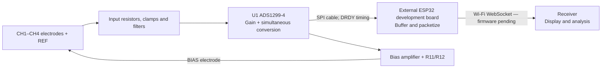

[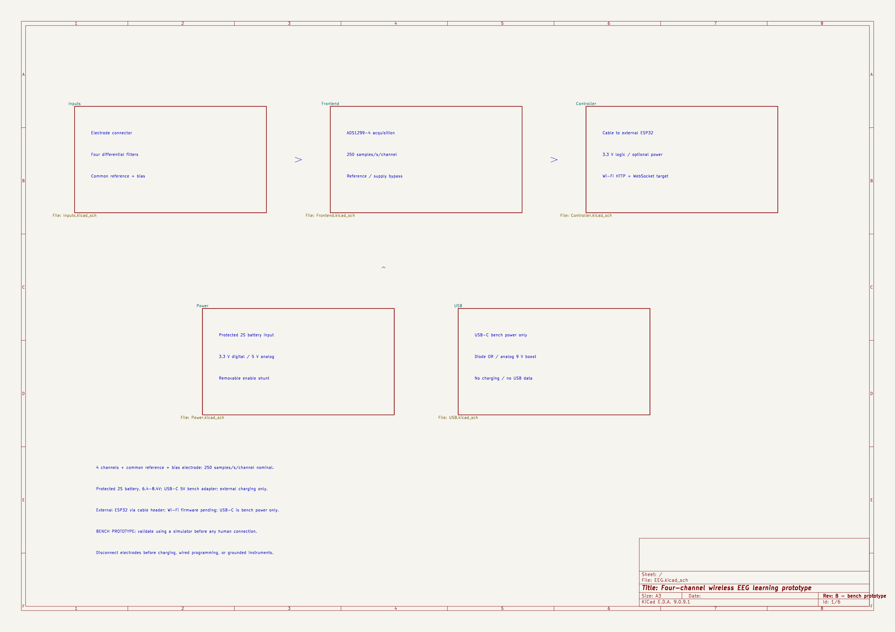](exports/previews/EEG.svg)

*The actual KiCad overview page maps the same functional blocks. Click the image for the vector version.*

The schematic pages follow the same division: **Inputs** prepares the electrode signals, **Frontend** contains the ADC and its support circuits, **Power** generates the supply rails, and **Controller** contains the external-board cable interface, and **USB** contains the bench input and analog boost. The root page is the map between them.

## What does a channel actually measure?

A voltage is always measured between two points. In this board, each ADC channel receives a positive input and a negative input:

$$
V_{\mathrm{diff},i}
= V_{P,i} - V_{N,i},
\qquad i \in \{1,2,3,4\}
$$

Here $V_{P,i}$ is the voltage at channel $i's positive ADC input (`CH1_ADC` through `CH4_ADC`), and $V_{N,i}$ is the voltage at its negative ADC input (`CH1_N` through `CH4_N`). These indexed mathematical symbols keep schematic net names separate from LaTeX subscripts.

Each channel's signed digital sample represents this differential voltage, scaled by the configured gain and ADC reference.

The four negative inputs originate at the same external **REF** electrode, but each has its own resistor/clamp branch. This is a shared-reference arrangement: the board measures four electrode-to-reference differences. It does not provide four separately accessible negative-electrode connections. Interference or movement at REF can therefore appear in several channels at once.

As a thought experiment, 2.500010 V at one input and 2.500000 V at the other produce a differential voltage of just 10 µV, despite both inputs sitting near 2.5 V. This is why the board needs both precise differential measurement and control of the average input voltage. These are illustrative numbers, not electrode voltages measured on this board.

Three different kinds of “reference” appear in this project. Keeping them distinct makes the rest of the schematic easier to read.

| Name                                   | What it does here                                                                               |
|----------------------------------------|-------------------------------------------------------------------------------------------------|
| **REF electrode**                      | The external comparison point for the four signal measurements.                                 |
| **ADC voltage reference, VREFP/VREFN** | Sets the conversion scale: how analog voltage becomes a digital number.                         |
| **BIAS electrode**                     | Carries the bias amplifier's driven output, intended to help control input common-mode voltage. |
| **GND**                                | The electronics' shared supply return. It is not an electrode pin on J1.                        |

Differential voltage and **common-mode voltage** are also different. If both ADC inputs rise by the same amount, their difference stays constant, but their average voltage rises. A differential ADC can reject much of that shared disturbance only while both inputs remain within their allowed operating range. Biasing and electrode impedance matter even when the desired difference is tiny.

## Why the inputs contain more than a wire

Open the **Inputs** sheet and trace channel 1. The following is a simplified electrical view; the clamp symbols stand for the paired diodes connected to GND and A5V.

```text
CH1 electrode ── R1 10k ──●── R2 10k ──●── CH1_ADC / ADC IN1P
                         │             │
                    D1 rail clamp      │
                                       C1 4.7nF
REF electrode ── R9 10k ──●── R10 10k ─●── CH1_N   / ADC IN1N
                         │
                    D5 rail clamp
```

[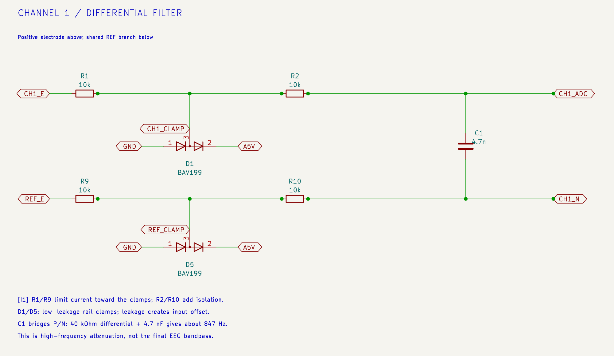](exports/previews/input-channel.svg)

*Inputs sheet, callout I1: trace CH1_E and REF_E through the two branches to the ADC pair. Click the image for the vector version.*

<details>
<summary>Open the full annotated Inputs schematic page</summary>

[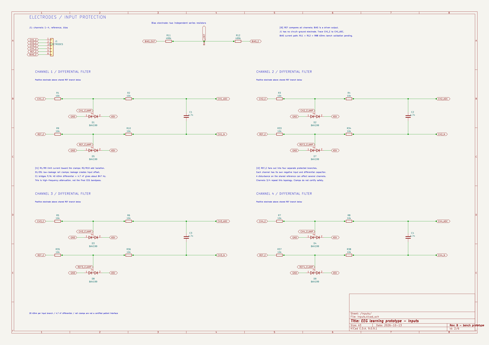](exports/previews/EEG-Inputs.svg)

</details>

The signal still reaches the ADC through resistors. The diodes sit on branches, and C1 connects across the two ADC inputs. Those positions explain their jobs.

### The resistors limit current, but they have a cost

R1 and R9 sit between the external connector and the clamp nodes. They reduce the current that can flow toward a conducting clamp during an excursion. R2 and R10 add resistance between those nodes and the ADC and participate in the differential filter.

Increasing resistance is not a free improvement. It also adds thermal noise, increases the offset caused by leakage current, and changes the response when combined with electrode impedance and capacitance. The two 10 kΩ resistors per branch are this revision's starting choice, to be evaluated on the bench. These networks are not certified patient, defibrillator or ESD protection.

The same pattern repeats across all four channels:

| Channel | Positive branch | Reference branch | Clamps | Differential capacitor |
|---------|-----------------|------------------|--------|------------------------|
| 1       | R1, R2          | R9, R10          | D1, D5 | C1                     |
| 2       | R3, R4          | R33, R34         | D2, D7 | C2                     |
| 3       | R5, R6          | R35, R36         | D3, D8 | C3                     |
| 4       | R7, R8          | R37, R38         | D4, D9 | C4                     |

### Why BAV199 diodes?

Normally the clamp diodes should contribute very little current to the input. Leakage matters because current through an impedance produces a voltage error: $V_{\mathrm{error}} = I_{\mathrm{leak}} R$. For example:

$$
V_{\mathrm{error}}
= (1\,\mathrm{nA})(20\,\mathrm{k}\Omega)
= 20\,\mu\mathrm{V}
$$
 That is an illustrative calculation, not a prediction of this board's leakage.

BAV199 is chosen for its low leakage. Each package contains two series-connected diodes, with their shared junction accessible at pin 3. Here, pin 1 goes to GND, pin 2 to A5V, and pin 3 to the clamp node. A large excursion can forward-bias one diode toward the corresponding rail. This is a leakage-conscious clamp choice, not a guarantee of transient survival; the rails also need to accommodate injected current. See [Nexperia's BAV199 data sheet](https://assets.nexperia.com/documents/data-sheet/BAV199.pdf).

### Why put C1 between the inputs?

C1–C4 provide a path for higher-frequency **differential** disturbances between the positive and negative inputs. Using one capacitor across the pair also avoids making this circuit depend on matching two separate capacitors to ground. It does not eliminate common-mode interference.

For a simplified small-signal model, with nonconducting clamps and negligible external source impedance, the resistance seen by C1 is the sum of both branches:

$$
\begin{aligned}
R_{\mathrm{diff}}
&= (10 + 10 + 10 + 10)\,\mathrm{k}\Omega
= 40\,\mathrm{k}\Omega \\
C_{\mathrm{diff}} &= 4.7\,\mathrm{nF} \\
f_c &\approx \frac{1}{2\pi R_{\mathrm{diff}} C_{\mathrm{diff}}} \\
&= \frac{1}{2\pi (40\times10^3)(4.7\times10^{-9})}\,\mathrm{Hz}
\approx 847\,\mathrm{Hz}
\end{aligned}
$$

This pole is well above the proposed 0.5–40 Hz application band. It is an input high-frequency attenuation stage, not the finished EEG bandpass or a complete anti-aliasing guarantee. Electrode impedance and parasitics change the actual response. The ADC's conversion/decimation behavior and later firmware filtering must be considered together.

C0G dielectric was selected for C1–C4 to keep the filter capacitance relatively stable. The larger supply capacitors use other dielectrics because their job is storing and delivering charge rather than setting this small-signal filter value.

## Why use a dedicated ADC instead of the processor's ADC?

**U1, ADS1299-4PAG**, combines four simultaneous conversion channels with programmable gain, a voltage reference, test facilities and a bias amplifier. That integration lets this project focus on electrode interfaces, supplies, layout and acquisition software rather than designing a separate precision amplifier chain for each channel. The four-channel variant matters: its pin usage and sample format must match the firmware. See the [TI ADS1299 family data sheet](https://www.ti.com/lit/ds/symlink/ads1299.pdf).

[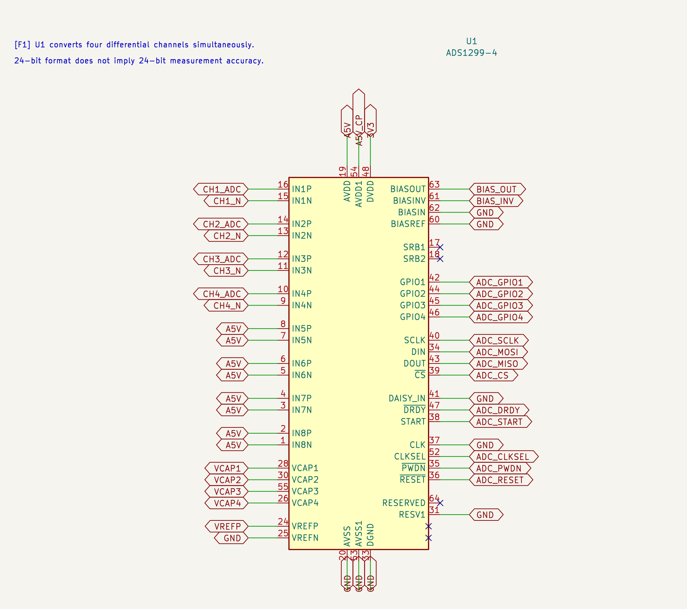](exports/previews/adc-core.svg)

*Frontend sheet, F1: the input pairs enter U1 at left; control and sample-transfer signals are at right. Click the image for the vector version.*

A **24-bit** output is a number format, not a promise of 24 useful bits of accuracy. Noise, offsets, gain error, the voltage reference and the input circuit determine what changes can actually be resolved. Likewise, programmable gain magnifies electrode offsets along with the wanted signal; using maximum gain immediately can cause clipping.

For that reason, initial firmware should use a modest gain, check raw offsets and saturation, and test known signals before choosing its operating gain. A smooth-looking plotted trace is weak evidence if the raw samples are already clipped or missing.

### Why all the capacitors around U1?

Some support the chip's internal circuits; others keep its external supplies locally steady. Their identical capacitor symbols hide very different responsibilities.

| Parts                       | Connection / purpose in this board                              |
|-----------------------------|-----------------------------------------------------------------|
| C6, 100 µF                  | VCAP1 support capacitor; polarized tantalum, positive at VCAP1. |
| C7, 1 µF                    | VCAP2 support capacitor.                                        |
| C8, 1 µF, and C9, 100 nF    | VCAP3 support capacitors.                                       |
| C10, 1 µF                   | VCAP4 support capacitor.                                        |
| C11, 10 µF, and C12, 100 nF | Bypass the conversion reference between VREFP and VREFN/GND.    |
| C13–C17, 1 µF each          | Local analog-supply bypass at the ADC supply groups.            |
| R14, 0 Ω, and C18, 1 µF     | Feed and bypass the separate A5V_CP supply branch.              |
| C19, 10 µF, and C20, 100 nF | Additional analog-rail bulk/local bypass.                       |
| C21, 1 µF, and C22, 100 nF  | Bypass the ADC's 3.3 V digital supply.                          |

[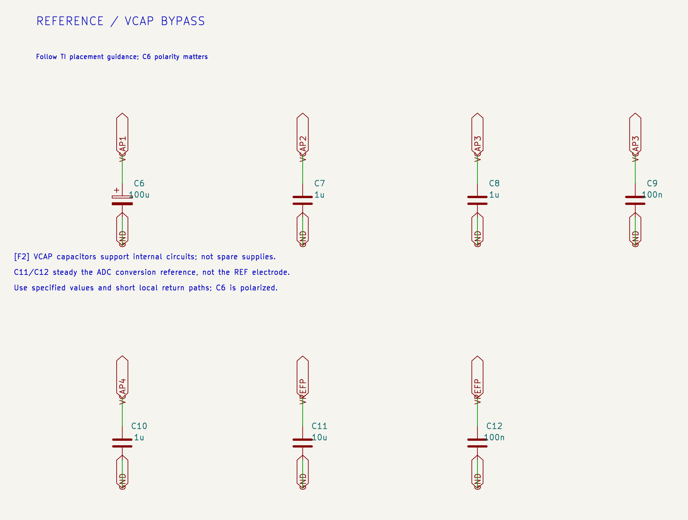](exports/previews/adc-support.svg)

*Frontend sheet, F2: VCAP networks and the VREFP bypass are different support circuits. Click the image for the vector version.*

<details>
<summary>Open the full annotated Frontend schematic page</summary>

[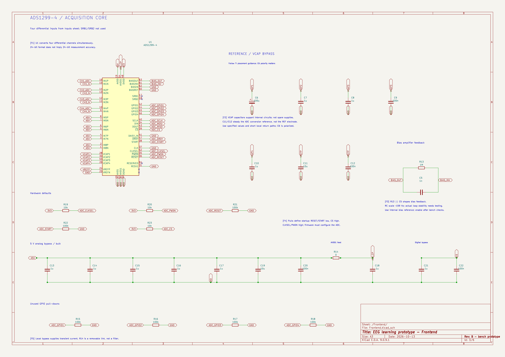](exports/previews/EEG-Frontend.svg)

</details>

The VCAP and reference values follow the device's single-supply application circuit; treat those pins according to their specified function rather than as spare power outputs. Local bypass capacitors give changing load currents a short path. A capacitor far away, connected through a long inductive route, cannot serve that job equally well.

R14 is a deliberate removable link. A zero-ohm resistor conducts like a connection but leaves an assembly point for isolating the branch or evaluating a future modification. It does not filter noise by itself.

### Hardware defaults keep startup understandable

The processor takes time to boot. Pull resistors give the ADC's control pins defined levels during that interval: R21/R22 hold RESET/START low, R23 holds chip select high, and R19/R20 select the internal clock and hold PWDN high. R15–R18 define the unused ADC GPIO inputs.

Firmware must then deliberately initialize the ADC. The unused SRB reference switches remain disabled because this board routes its reference through four external branches. Clock output stays disabled because the external clock pin is grounded. Changing register settings can make correctly wired hardware behave incorrectly.

## Why there is a separate bias circuit

A signal can have a small differential voltage and still sit at an unsuitable common-mode voltage. The bias circuit addresses that separate problem. Its intended behavior is a feedback loop: observe selected channel common-mode information, generate a corrective output, and couple that output through the BIAS electrode path.

```text
Selected input common-mode information
                  │
                  v
       ADS1299 internal bias amplifier
                  │ BIAS_OUT
                  ├── R11 499k ── R12 499k ── BIAS electrode
                  │
                  └── [ R13 1M || C5 1nF ] ── BIAS_INV
                              feedback
```

[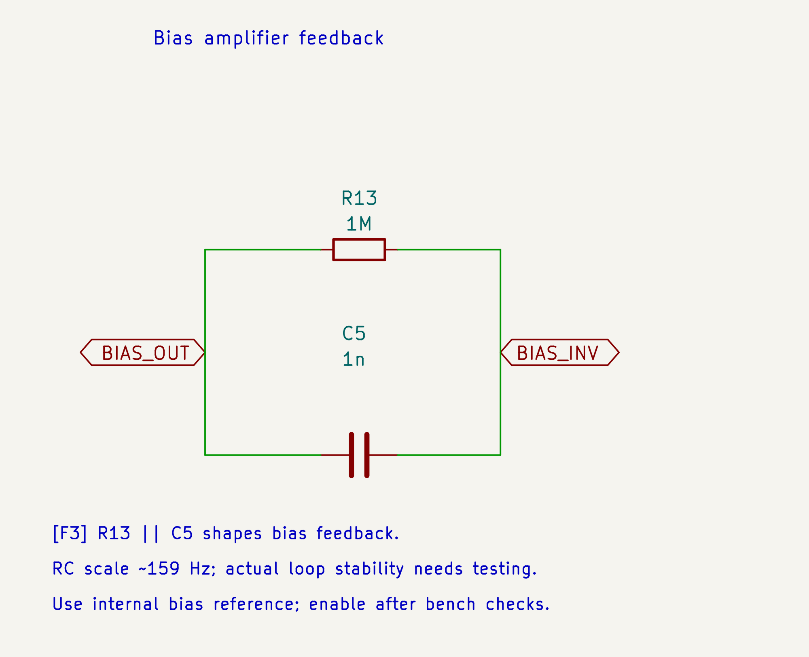](exports/previews/bias-feedback.svg)

*Frontend sheet, F3: R13 and C5 share both endpoints, forming the parallel feedback network. Click the image for the vector version.*

R13 and C5 are in parallel in the amplifier's feedback path. The resistor provides the resistive feedback path; the capacitor changes the loop's frequency response. Their RC frequency scale is:

$$
f_{\mathrm{RC}} = \frac{1}{2\pi R_{13} C_5}
= \frac{1}{2\pi (1\times10^6)(1\times10^{-9})}\,\mathrm{Hz}
\approx 159\,\mathrm{Hz}
$$

**That is not a measured closed-loop bandwidth**: the channel sensing configuration, amplifier behavior and external electrode/load network also affect the loop.

R11 and R12 total 998 kΩ in series with the driven output, limiting current for a given voltage difference. Having two resistors leaves resistance if one is shorted, but this observation is not a safety qualification. The feedback returns from BIAS_OUT before those resistors; the external electrode path must still be evaluated with a simulated load.

This revision uses the ADC's internal bias reference. BIASREF and unused BIASIN are grounded. Enable the amplifier only after verifying the configuration and checking stability. REF is a measurement input; BIAS is an actively driven output. They are not interchangeable connector pins.

## Two supply rails, two different priorities

The ADC analog circuits need a regulated 5 V rail, while digital logic and the external ESP32 use 3.3 V. Revision B accepts either a protected 2S battery or a 5 V USB-C bench adapter. USB cannot reliably feed the old 5 V LDO directly: the input diode, cable drop and regulator dropout would leave too little headroom. The added boost converts the selected input to nominally 9.04 V for the low-current analog branch, followed by the existing 5 V LDO. The external controller's higher-current supply comes from the separate 3.3 V buck.

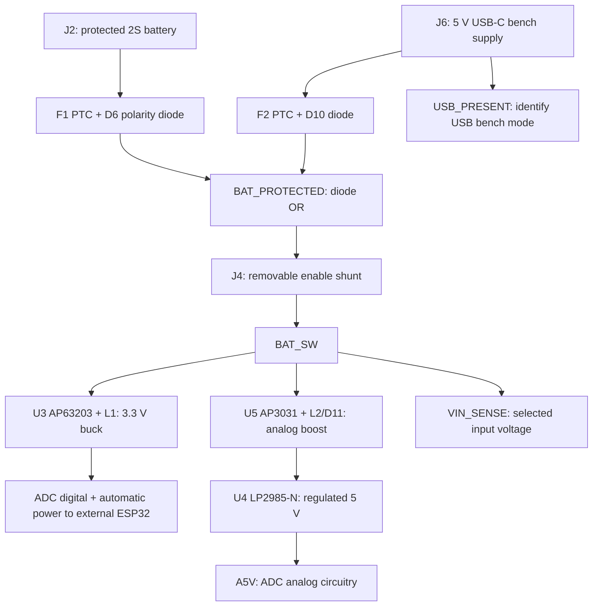

Both sources share ground. D6/D10 steer normal source current and resist backfeed; they do not isolate a USB-connected computer or supply. If both sources are present, the higher battery voltage normally supplies the board. Connecting USB still creates a wired ground connection, so USB operation is for bench fixtures with electrode cables disconnected. There is no battery charging or USB data connection on this EEG board.

### Fuses, source diodes and J4: different jobs

[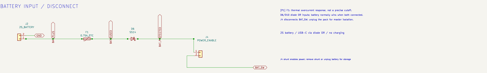](exports/previews/battery-power.svg)

*Power sheet, P1: the battery passes through three separate functions before reaching BAT_SW. Click the image for the vector version.*

**F1 and F2**, 0.75 A-hold PTCs, increase resistance when sufficiently heated by excess current. Its response depends on current and temperature; it is not a precise 0.75 A electronic cutoff. The pack still requires its own protection.

**D6**, an SS14 Schottky diode, blocks a reversed battery connection; **D10** provides the USB branch of the diode OR. Its forward drop costs some voltage and dissipates heat. That loss needs to be included when checking regulator headroom at low battery voltage.

**J4** turns the downstream circuit on when a suitably rated shunt joins its two pins. Removing it disconnects BAT_SW, but the battery-side parts remain connected to the pack. Unplugging the pack is the master disconnect. There is no onboard charger: remove the pack for compatible offboard charging.

### Why the 3.3 V regulator switches

A linear regulator converting roughly 7.4 V to 3.3 V would turn the voltage difference into heat. As an illustration, at 100 mA:

$$
\begin{aligned}
P_{\mathrm{loss}} &\approx (V_{\mathrm{in}}-V_{\mathrm{out}}) I_{\mathrm{load}} \\
&= (7.4-3.3)\,\mathrm{V}\times0.1\,\mathrm{A}
= 0.41\,\mathrm{W}
\end{aligned}
$$

That is not a measured radio load. It explains the motivation for **U3, AP63203**, a fixed-3.3 V switching buck. Its switching stage transfers energy through **L1, 4.7 µH**, and the output capacitors. The tradeoff is switching ripple and fast current loops that need attention in layout and measurement. See the [AP63203 family data sheet](https://www.diodes.com/datasheet/download/AP63200-AP63201-AP63203-AP63205.pdf).

[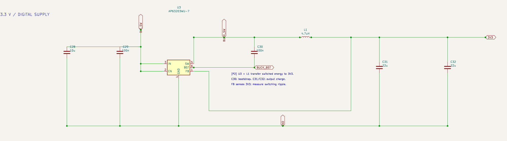](exports/previews/buck-supply.svg)

*Power sheet, P2: identify the bootstrap capacitor, inductor, output capacitors and feedback connection. Click the image for the vector version.*

C28/C29 bypass its input. C30 is the bootstrap capacitor between BST and SW, supporting the high-side gate-drive circuit. C31/C32 store charge at the output, and FB senses the resulting 3.3 V rail. L1's saturation and current ratings provide design margin; a high inductor current rating does not mean the EEG board normally draws that current.

### Why the power LED has its own resistor

**D13** is a small green 0805 LED; **R45** limits its current from the digital 3.3 V rail. The branch is wired as:

```text
3V3 ── R45 (1 kΩ) ── D13 anode → cathode ── GND
```

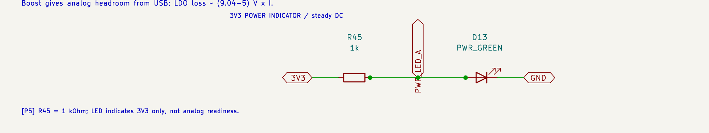

Using the [Kingbright datasheet](https://www.kingbrightusa.com/images/catalog/spec/apt2012lzgck.pdf) nominal forward voltage of 2.65 V at its 2 mA test current gives an illustrative estimate:

$$
I_{\mathrm{LED}} \approx \frac{V_{\mathrm{3V3}}-V_F}{R_{45}}
= \frac{3.3\,\mathrm{V}-2.65\,\mathrm{V}}{1\,\mathrm{k}\Omega}
= 0.65\,\mathrm{mA}
$$

The actual forward voltage changes with current and temperature, so measure the fitted LED current and brightness on the bench. A steady indicator avoids adding a blinking load. Its extra current still reduces battery runtime slightly.

The LED indicates **3V3 present**, whether powered from the battery or USB-C through J4. It does not confirm A5V, correct ADC configuration, safe electrode connection or sufficient battery charge. It is not a charger indicator. If an external board back-powers 3V3 through J5 pin 2, the LED may also light. Disconnect that power cable before powering the external board from its own USB.

### What the USB-C circuit does

J6 is a GCT USB4105 receptacle. R39/R40 each provide a separate 5.1 kΩ sink termination on CC1/CC2, so a suitable USB-C source can detect the connection in either orientation. F2 supplies the input's overcurrent response, D10 steers its power into the shared supply node, and D12 is a VBUS transient suppressor. A connector's current rating does not negotiate source current.

Use a dedicated **5 V USB-C bench adapter rated at least 1 A**, with a suitable cable; verify its behavior under the actual load. This revision does not implement USB enumeration, Type-C advertised-current decoding or Power Delivery, and is not intended to draw its full load from an arbitrary computer USB port. D+/D− and SBU pins are explicitly unconnected. Program the external ESP32 through that development board's own USB port, following the power-link rule below.

[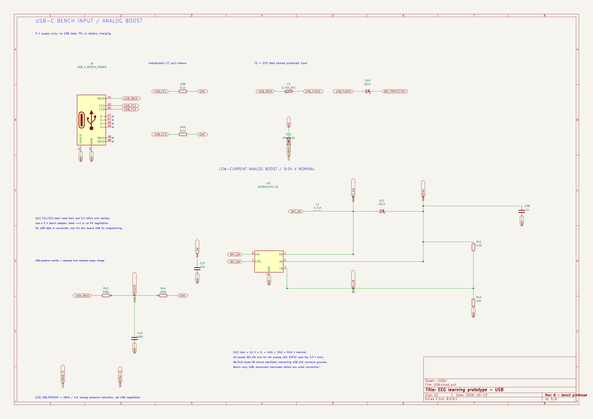](exports/previews/EEG-USB.svg)

*USB sheet: U1 explains the CC terminations; U2 identifies the analog boost and the USB ground boundary. Click for the vector drawing.*

### Why add a boost before the analog regulator?

The battery supply is above 5 V, but a USB input after a diode can be below it. The AP3031 boost, U5, provides headroom for the analog LDO in both cases. It supplies the ADC analog branch, not the external ESP32. L2 stores energy, D11 rectifies the switching output, C37 bypasses the input and C38 supports the output. R41/R42 set the nominal voltage using the boost's 0.2 V feedback reference:

$$
V_{\mathrm{BOOST}} = V_{\mathrm{FB}}\left(1+\frac{R_{41}}{R_{42}}\right)
= 0.2\,\mathrm{V}\left(1+\frac{442\,\mathrm{k}\Omega}{10\,\mathrm{k}\Omega}\right)
= 9.04\,\mathrm{V}
$$

That result is nominal: feedback-reference tolerance, resistor tolerance and load affect the actual voltage. The extra switching stage adds components and another noise source, so its loop is kept away from the electrode section. The LDO then drops the boosted voltage to 5 V. Startup, boost stability, analog ripple and noise must be measured. The [AP3031 data sheet](https://www.diodes.com/assets/Datasheets/AP3031.pdf) includes voltage-divider boost applications as well as its LED-driver applications.

### Why the analog rail uses a linear regulator

**U4, LP2985-N**, makes A5V from BOOST9V. The LDO adds a linear stage after the boost, at the cost of heat approximately proportional to voltage drop times load current. C33 bypasses its input, C34 bypasses its internal noise-related node, and C35/C36 support the output.

[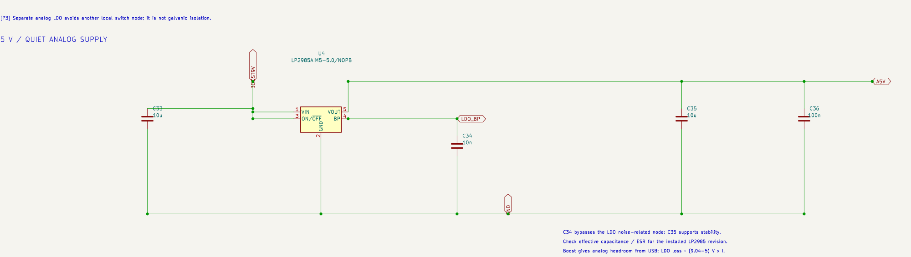](exports/previews/analog-supply.svg)

*Power sheet, P3: follow BOOST9V to the LDO and A5V; C34 and C35 serve different purposes. Click the image for the vector version.*

<details>
<summary>Open the full annotated Power schematic page</summary>

[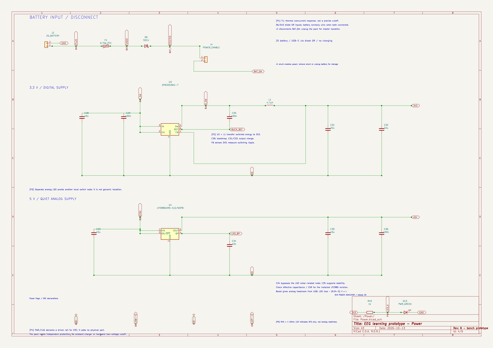](exports/previews/EEG-Power.svg)

</details>

The output capacitor is part of the regulator's stability system. TI documents different capacitance/ESR considerations for legacy and newer silicon; the installed device and effective ceramic capacitance must be checked rather than assuming any nominal 10 µF capacitor is suitable. Startup, load steps, ripple and oscillation are bench checks still to perform. See [TI's LP2985-N data sheet](https://www.ti.com/lit/ds/symlink/lp2985-n.pdf).

### Why capacitor voltage ratings exceed the rail voltage

A ceramic capacitor's printed value is not necessarily its capacitance in operation. DC bias, temperature and tolerance can reduce it, particularly for larger X5R/X7R values. The BOM uses voltage headroom, including 25 V parts for the 22 µF capacitors, to help manage this tradeoff. Actual effective capacitance still needs checking from the selected part's characteristics. The voltage rating alone does not prove the regulator will be stable.

## The external controller coordinates acquisition

Revision B replaces U2 and its onboard RF, reset, boot and UART circuits with **J5**, a labeled 2×6 cable header. An already-assembled ESP32 development board handles those functions. There is no footprint or antenna on the EEG PCB that must match a particular development board; wire by signal name and verify the actual board's GPIO labels.

[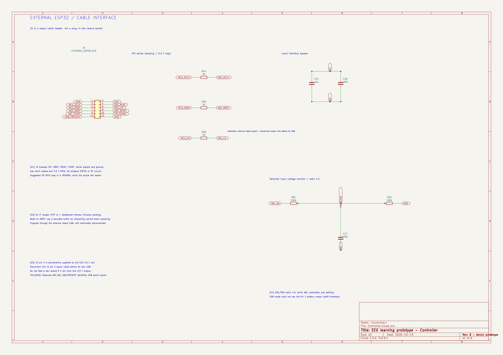](exports/previews/EEG-Controller.svg)

*Controller sheet: C1 identifies the cable interface, C2 explains acquisition versus networking timing, and C3 explains the optional power link. Click for the vector drawing.*

`USB_PRESENT` and `VIN_SENSE` are the two voltage-monitor nets. J5 pin 2 is permanently connected to **3V3** and automatically supplies the external development board when the EEG rail is powered.

All signal pins use **3.3 V logic**. Keep the SPI cable short, run signal returns beside it, and start at the conservative 1 MHz SPI clock. Long jumper cables are not equivalent to short PCB traces; verify ringing and reliable frame transfers before increasing the clock. R24–R26 remain as 33 Ω series resistors on SCLK/MOSI/CS, though their placement at this board end of a cable cannot substitute for checking the actual source and cable behavior. If needed, place additional damping at the external controller's driving pins after measurement.

The ADC's DRDY pin indicates conversion data readiness. SPI transfers the frames. A bounded acquisition buffer separates sampling from variable network timing:

```text
DRDY → read ADC frame → sample buffer → Wi-Fi WebSocket packet → browser/receiver
        timing-critical                network timing varies
```

A practical firmware target is to serve the browser page over HTTP and stream batched binary samples through a WebSocket. HTTP endpoints can expose configuration and status. Include sequence numbers, timestamps, dropped-frame counts and saturation flags; a slow client must not block the acquisition task. ESP-IDF provides [HTTP and WebSocket server support](https://docs.espressif.com/projects/esp-idf/en/stable/esp32s3/api-reference/protocols/esp_http_server.html). These are documented firmware targets, not an implemented server.

### Powering and programming the external board

J5 pin 2 connects directly to the EEG board's 3.3 V rail; there is no separate ESP32 power jumper. Connect it to a compatible development board's **3V3** input. This is not a 5 V/VIN output. The design budget for the external load is 500 mA at 3.3 V, subject to regulator thermal, transient and assembled-board verification. C24/C25 provide local interface bypass; the external development board retains its own capacitors and regulator circuitry.

**Disconnect the J5 pin 2 power wire before connecting the development board's own USB power/programmer.** Do not join two independently powered 3.3 V outputs. Espressif describes USB, 5 V header and 3.3 V header supply options as mutually exclusive for its DevKitC-1; verify that the purchased board follows that behavior. See the [official development-board guide](https://documentation.espressif.com/esp-dev-kits/en/latest/esp32s3/esp32-s3-devkitc-1/user_guide_v1.0.html).

For programming, disconnect electrode cables and the J5 pin 2 power wire, and use the external board's own USB and buttons. USB data is not routed through J6 on the EEG PCB. For battery-only acquisition tests, disconnect wired programming equipment and use Wi-Fi; keep the bench-only validation boundary in mind.

### Why the supply and USB presence need dividers

The processor must not see the full selected input voltage on its ADC pin. R31, 330 kΩ, and R32, 100 kΩ, divide BAT_SW down:

$$
\begin{aligned}
V_{\mathrm{sense}}
&= V_{\mathrm{IN}}\frac{R_{32}}{R_{31}+R_{32}} \\
&= V_{\mathrm{IN}}\frac{100}{330+100}
= \frac{V_{\mathrm{IN}}}{4.3} \\
V_{\mathrm{sense}}\big|_{V_{\mathrm{IN}}=8.4\,\mathrm{V}}
&\approx 1.95\,\mathrm{V} \\
I_{\mathrm{divider}}
&= \frac{V_{\mathrm{IN}}}{R_{31}+R_{32}}
= \frac{8.4\,\mathrm{V}}{430\,\mathrm{k}\Omega}
\approx 19.5\,\mu\mathrm{A}
\end{aligned}
$$

[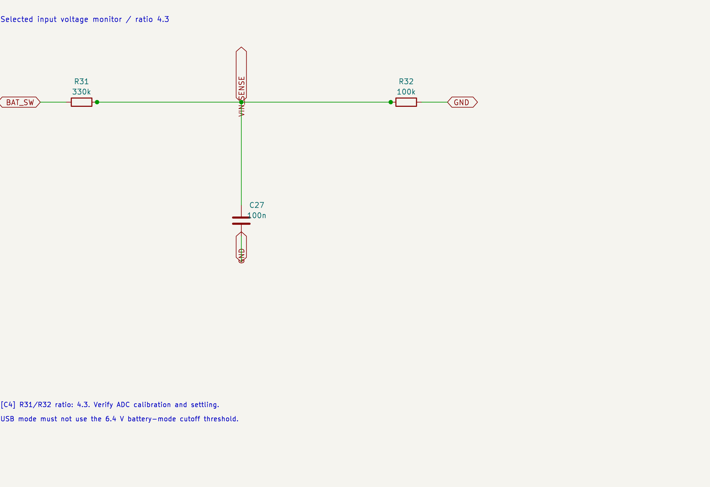](exports/previews/battery-monitor.svg)

*Controller sheet, C4: R31/R32 set the scale; C27 supplies local charge at the sense node. Click the image for the vector version.*

Large resistors keep the divider's continuous battery drain small. Their higher source impedance makes the measurement more sensitive to ADC loading and settling. C27, 100 nF, provides local charge and smooths fast changes; its nominal divider time constant, ignoring ADC loading, is:

$$
\tau = (R_{31}\parallel R_{32}) C_{27}
= \frac{(330\,\mathrm{k}\Omega)(100\,\mathrm{k}\Omega)}
{430\,\mathrm{k}\Omega}\times100\,\mathrm{nF}
\approx 7.7\,\mathrm{ms}
$$

ADC attenuation, calibration and acquisition timing still need verification.

R31/R32/C27 **measure BAT_SW**, which represents battery voltage after the input diode in battery mode and USB voltage after its diode in bench mode. R43/R44/C40 independently measure USB_VBUS with the same 4.3 divider ratio, giving about 1.16 V at 5 V USB input. Use USB_PRESENT to select the appropriate firmware power policy: the 6.4 V battery floor must not be applied to a 5 V bench input. It does not disconnect the battery. Firmware can stop acquisition at the proposed loaded-pack floor, but the regulators keep consuming current while J4 is fitted. Independent pack protection and physically disconnecting power remain separate responsibilities.

## The PCB is part of the circuit

A schematic shows connectivity; the PCB determines where currents actually flow. Input leakage can come from flux residue, interference can couple through nearby traces, and shared return paths can turn radio or regulator current into an unwanted analog voltage.

This revision uses two copper layers with ground pours and stitching vias. Its analog inputs, buck and boost switching loops should be inspected with their different sensitivities in mind. Ground copper is useful, but it cannot by itself prove low-noise performance. The [top preview](exports/previews/pcb-top.png) is a useful map; open the routed board for layer-by-layer inspection.

There is no antenna clearance region on this board because the radio is external. Keep the development board and its antenna physically away from electrode cables and the analog front end during measurements. Four mounting holes form a symmetric square and are board-only mechanical features, with clearance for 6 mm nonconductive mounting hardware. The four input rows run in connector order (CH1 through CH4), with 3.75 mm pitch and shared resistor/clamp/filter columns. The four reference branches also use 3.75 mm pitch. ADC support capacitors share aligned rows. The ADC U1 is exactly at local **(0, 0)**, the center of the square outline spanning -30 to +30 mm on both local axes. The whole board sits at the center of the A4 drawing sheet: absolute KiCad position **(148.5, 105) mm**, with the grid and placement/drill origins set to the ADC. This keeps the PCB inside the sheet while preserving centered fabrication coordinates. The electrode connector J1 and its eight protection branches are centered vertically on the left, and the external ESP32 header J5 is centered vertically on the right. USB-C is on the bottom edge, the battery connector is at the top, and switching/power circuits occupy top and bottom bands. All placement and drill exports use this local origin; Gerbers use the same origin so the manufacturing layers align. Switching components remain grouped by electrical function; small component references appear inside component bodies on F.Fab in the [current assembly preview](exports/previews/pcb-assembly.png).

The outline is **60 × 60 mm**, within the required **100 × 100 mm maximum**. Compared with the previous 80 × 80 mm square layout:

$$
\text{Area reduction}=1-\frac{60\times60}{80\times80}=43.75\%
$$

The 60 mm square is a compact practical layout using the existing 0805/1206 passives, through-hole connectors, four mounting holes and two power inputs. It is not a proven mathematical minimum. Further shrinking would require revisiting connector sizes, mounting clearances, component packages or assembly access.

This revision retains **two copper layers** for the dense TQFP fanout, return paths and routing. A one-sided version would need a separately validated layout with jumpers or substantial rearrangement; removing the bottom Gerber from this board would break connections. PCB price depends on the fabricator and order size, so the smaller area is verified while any cost saving remains unquoted. The external development board is an additional purchased assembly. USB support also adds power components, so fewer onboard RF parts do not imply fewer total PCB parts.

## What does one prototype cost?

The **PCB component planning subtotal is approximately $78.64 USD** for all **104 electrical parts** in the current design manifest. Prices were checked against public distributor listings on **2026-10-13**; listings may be cached and are not binding quotes. The tables use single-piece price anchors multiplied by the fitted quantity. Quantity discounts, minimum orders, spares, taxes, shipping, assembly and PCB fabrication are excluded.

Prices mix distributor listings, budgeting allowances and replacement-candidate estimates. Several capacitor MPNs are obsolete or unverified: candidates need electrical, footprint and availability review before ordering. These tables do not change the CAD or approve substitutions. The exported BOM matches the current Revision B design, while unverified part numbers still need sourcing review.

### Active components — ICs, diodes and LED

| Fitted references | Value / part | What it is / use | Design MPN | Qty | Unit USD |
| --- | --- | --- | --- | ---: | ---: |
| U1 | ADS1299-4 | Four-channel EEG analog front end; amplifies and digitizes electrode voltages. | `ADS1299-4PAG` | 1 | $44.99 |
| U3 | AP63203WU-7 | Buck switching regulator; steps the selected power input down to 3.3 V. | `AP63203WU-7` | 1 | $0.89 |
| U4 | LP2985AIM5-5.0/NOPB | Low-noise linear regulator; produces the ADC’s 5 V analog supply. | `LP2985AIM5-5.0/NOPB` | 1 | $0.72 |
| U5 | AP3031KTR-G1 | Boost switching regulator; raises the selected input to about 9 V for U4. | `AP3031KTR-G1` | 1 | $0.33 |
| D1, D2, D3, D4, D5, D7, D8, D9 | BAV199 | Low-leakage dual diodes; clamp excessive input voltages in the electrode branches. | `BAV199,215` | 8 | $0.18 |
| D6, D10, D11 | SS14 | Schottky diodes; D6 protects/steers battery power, D10 steers USB power, D11 rectifies the boost output. | `SS14` | 3 | $0.40 |
| D12 | SMAJ5.0A | TVS diode; suppresses voltage transients on USB VBUS. | `SMAJ5.0A` | 1 | $0.60 |
| D13 | PWR_GREEN | Green LED; indicates that the 3.3 V rail is powered. | `APT2012LZGCK` | 1 | $0.50 |

### Passive components

Resistors set gains, current limits and voltage ratios; capacitors filter and stabilize supplies; inductors store energy in the switching converters.

#### Resistors

| Fitted references | Value | Design MPN | Qty | Unit USD |
| --- | --- | --- | ---: | ---: |
| R1, R2, R3, R4, R5, R6, R7, R8, R9, R10, R19, R20, R23, R33, R34, R35, R36, R37, R38, R42 | 10 kΩ | `RC0805FR-0710KL` | 20 | $0.10 |
| R11, R12 | 499 kΩ | `RC0805FR-07499KL` | 2 | $0.10 |
| R13 | 1 MΩ | `RC0805FR-071ML` | 1 | $0.10 |
| R14 | 0 Ω | `RC0805JR-070RL` | 1 | $0.10 |
| R15, R16, R17, R18, R21, R22, R32, R44 | 100 kΩ | `RC0805FR-07100KL` | 8 | $0.10 |
| R24, R25, R26 | 33 Ω | `RC0805FR-0733RL` | 3 | $0.10 |
| R31, R43 | 330 kΩ | `RC0805FR-07330KL` | 2 | $0.10 |
| R39, R40 | 5.1 kΩ | `RC0805FR-075K1L` | 2 | $0.10 |
| R41 | 442 kΩ | `RC0805FR-07442KL` | 1 | $0.10 |
| R45 | 1 kΩ | `RC0805FR-071KL` | 1 | $0.10 |

#### Capacitors

| Fitted references | Value | Type / polarity | Design MPN | Qty | Unit USD |
| --- | --- | --- | --- | ---: | ---: |
| C1, C2, C3, C4 | 4.7 nF | Ceramic; non-polarized | `GRM21A5C1H472JA01D` | 4 | $0.54 |
| C5 | 1 nF | Ceramic; non-polarized | `GRM21A5C1H102JA01D` | 1 | $0.65 |
| C6 | 100 µF | Tantalum; **polarized (+/−)** | `T491D107K010AT` | 1 | $1.50 |
| C7, C8, C10, C13, C14, C15, C16, C17, C18, C21, C38 | 1 µF | Ceramic; non-polarized | `GRM21BR71E105KA99L` | 11 | $0.30 |
| C9, C12, C20, C22, C25, C27, C29, C30, C36, C40 | 100 nF | Ceramic; non-polarized | `GRM21BR71H104KA01L` | 10 | $0.15 |
| C11, C19, C24, C28, C33, C35, C37 | 10 µF | Ceramic; non-polarized | `GRM31CR71C106KA12L` | 7 | $0.99 |
| C31, C32 | 22 µF | Ceramic; non-polarized | `GRM31CR61E226KE15L` | 2 | $0.48 |
| C34 | 10 nF | Ceramic; non-polarized | `GRM21A5C1H103JA01D` | 1 | $0.75 |

#### Inductors

| Fitted references | Value | Design MPN | Qty | Unit USD |
| --- | --- | --- | ---: | ---: |
| L1, L2 | 4.7 µH | `SRP5030T-4R7M` | 2 | $1.00 |

### Connectors and resettable fuses

| Fitted references | Value / part | Design MPN | Qty | Unit USD |
| --- | --- | --- | ---: | ---: |
| J1 | ELECTRODES | `B6B-XH-A` | 1 | $0.18 |
| J2 | 2S_BATTERY | `B2B-XH-A` | 1 | $0.10 |
| J4 | POWER_ENABLE | `61300211121` | 1 | $0.25 |
| J5 | EXTERNAL_ESP32_3V3 | `61301221121` | 1 | $0.79 |
| J6 | USB_C_BENCH_POWER | `USB4105-GF-A` | 1 | $0.80 |
| F1, F2 | 0.75A_PTC | `1812L075/24DR` | 2 | $1.00 |

The ADC alone accounts for about 57% of this subtotal. Reducing PCB area can help fabrication cost, but it does not reduce the ADC price. The schematic's power flags are software symbols and cost nothing; mounting holes also require no electrical part.

External items need their own budget. The following are **unquoted planning allowances**, since exact models have not been selected:

| External item | Allowance USD |
| --- | ---: |
| ESP32-S3 development board | $10–20 |
| Commercially protected/balanced 2S battery pack | $15–30 |
| Compatible offboard 2S charger | $10–20 |
| Dedicated 5 V USB-C adapter and cable | $5–15 |
| Header cables, mating connector housings/crimps, shunts and nonconductive spacers | $5–15 |
| **External-item allowance subtotal** | **$45–100** |

Together, components and these accessories suggest **$123.64–$178.64 USD**, before PCB fabrication, assembly, enclosure, electrodes, test equipment, shipping and taxes. Obtain separate quotes for those excluded items. USB-C on this board does not charge the pack; the offboard charger is a separate purchase.

## What must software add?

The hardware ends at digitized samples and a programmable processor. Firmware must initialize the ADC, establish sample timing, detect saturation, track missing samples, measure battery voltage and send recoverable Wi-Fi packets. The receiver then interprets those packets and applies the intended display/analysis filters.

The proposed starting point is **250 samples/s per channel**, with later 0.5–40 Hz filtering and selectable 50/60 Hz rejection. The channel-value payload alone is:

$$
\begin{aligned}
\text{Payload rate}
&= N_{\mathrm{channels}}\times\frac{N_{\mathrm{bits}}}{8}\times f_s \\
&= 4\times\frac{24}{8}\times250\,\mathrm{Hz}
= 3{,}000\,\mathrm{bytes/s}
\end{aligned}
$$

ADC status, timestamps and packet overhead add to that rate. Packet size, buffering and Wi-Fi behavior still need implementation and testing.

Keep raw acquisition and filtered display data distinguishable. A mains notch can reduce a visible interference line, but it cannot repair an ADC that clipped before the data reached software. The detailed GPIO mapping and initialization expectations follow.

## Connector and firmware reference

Pin numbers refer to CAD pad numbers, not a viewpoint-dependent cable order. Verify continuity before connecting a harness.

| Connector            |       Pin | Function                                                   |
|----------------------|----------:|------------------------------------------------------------|
| J1, JST XH 6-pin     |       1–4 | CH1–CH4 electrode inputs                                   |
| J1                   |     5 / 6 | REF measurement electrode / BIAS driven electrode          |
| J2, JST XH 2-pin     |     1 / 2 | Protected 2S battery positive / GND                        |
| J4                   |       1–2 | Shunt enables BAT_SW for either source                     |
| J6                   |     USB-C | 5 V bench power only; no data, PD or charging              |
| J5, 2×6 cable header |    1 / 12 | GND returns                                                |
| J5                   |         2 | 3V3: automatic supply to compatible ESP32 3V3 input, not 5 V               |
| J5                   |     3 / 4 | MCU_SCLK / ADC_MISO                                        |
| J5                   |     5 / 6 | MCU_MOSI / MCU_CS                                          |
| J5                   | 7 / 8 / 9 | ADC_DRDY / ADC_RESET / ADC_START                           |
| J5                   |   10 / 11 | VIN_SENSE / USB_PRESENT, analog inputs to external MCU     |

J5 is a signal connector, not a socket that matches the development board's physical header rows. Pin numbers refer to PCB pad numbers; verify continuity when making the harness. Charge the protected 2S pack offboard with its compatible charger.

### Firmware interface — implementation pending

Suggested **ESP32-S3** GPIO assignments below avoid its USB pins and usual boot straps. They are wiring recommendations, not a universal mapping for every ESP32 family or clone. The CafeRobot board is a candidate external assembly; confirm the purchased board's pin labels and power inputs before attaching it.

| J5 pin | EEG signal  | Suggested S3 GPIO | Direction from MCU |
|-------:|-------------|------------------:|--------------------|
|      3 | MCU_SCLK    |                12 | Output             |
|      4 | ADC_MISO    |                 4 | Input              |
|      5 | MCU_MOSI    |                11 | Output             |
|      6 | MCU_CS      |                10 | Output             |
|      7 | ADC_DRDY    |                 9 | Input / interrupt  |
|      8 | ADC_RESET   |                 6 | Output             |
|      9 | ADC_START   |                 7 | Output             |
|     10 | VIN_SENSE   |                 5 | Analog input       |
|     11 | USB_PRESENT |                 8 | Analog input       |

Use SPI mode 1, initially at a conservative 1 MHz, and honor all command/reset timing in the TI data sheet. External START and RESET are held low until firmware intentionally initializes the ADC. PWDN and CLKSEL are pulled high. Keep chip select high while resetting and send SDATAC before register access.

For initial configuration, select 250 samples/s, internal reference, internal clock, clock output disabled, SRB1/SRB2 disabled, and four normal differential channels. Start with modest PGA gain (for example 12) and confirm offsets do not saturate the input range. Explicitly configure the internal bias reference, power the bias buffer only after bench checks, and select appropriate bias sense channels. Disable lead-off excitation during the initial noise test. Do not rely on power-on register defaults.

Read the device ID and programmed registers back. Validate the **ADS1299-4** data-frame size against the data sheet; do not copy an eight-channel driver's frame length unchanged. Capture DRDY timestamps and signed 24-bit values, then stream over Wi-Fi WebSocket with sample sequence numbers, battery voltage, saturation flags, and dropped-sample accounting. Use a bounded acquisition buffer so radio delays cannot block ADC service. Nominal application filtering is 0.5–40 Hz with selectable 50/60 Hz rejection, after verifying raw acquisition.

`VIN_SENSE`, represented by $V_{\mathrm{sense}}$ in the equations, uses 330 kΩ/100 kΩ and 100 nF: ideal selected-input voltage is $V_{\mathrm{IN}} = 4.3\,V_{\mathrm{sense}}$. At 8.4 V the ADC pin is about 1.95 V; choose appropriate attenuation and use ADC calibration. In battery mode, stop acquisition at the chosen loaded-pack floor, accounting for D6 drop; in USB bench mode use a separate supply policy. The original 6.4 V battery target needs calibration against actual pack voltage; independent pack protection remains necessary. With the shunt fitted, regulators still consume current after software stops. Remove the shunt or unplug the pack for storage. The 6.4 V threshold is an operating target, not a measured protection guarantee.

## Bringing the board to life on the bench

1. Inspect soldering, polarity and connector numbering; check resistance between BAT_SW/GND, 3V3/GND and A5V/GND before applying power. Look for bridges on ADC and regulator pads. No electrode cable attached.
2. With no human connection, initially power from a current-limited bench source at approximately 7.4 V through J2. Establish expected idle current; a current limit alone does not prove correct operation. Check 3V3 against the external controller's verified 3.3 V supply limits and A5V against the ADC's 4.75–5.25 V range.
3. Check startup, steady-state ripple and load-step response at local bypass capacitors with a short ground connection. Measure BOOST9V startup/ripple under analog load and inspect the LDO output for oscillation; confirm effective output capacitance and ESR meet the relevant LP2985-N chip revision requirements. Check regulator and diode temperature.
4. Program the external ESP32 through its own USB with electrode leads disconnected and the J5 pin 2 power wire disconnected. Read ADC ID, registers and DRDY; exercise internal test signals and verify gain/scaling and channel order. Confirm RESET/START startup behavior across repeated power cycles.
5. Use an isolated signal simulator or bench fixtures, never a person for this stage. Measure shorted-input noise and offsets. Then apply small differential sine waves around the appropriate analog common-mode voltage through representative source resistances. Check clipping, common-mode rejection, mains pickup and reference filter branches.
6. Enable and test the bias loop with a simulated electrode/load network. Verify stability, output range and resistor-chain continuity. Exercise detached electrodes and saturation, Wi-Fi reconnects, dropped packets and loaded-battery shutdown.
7. Repeat acquisition on the protected battery with all wired bench equipment disconnected. Independent safety and analog-performance review is required before considering recording on a person.

## Find the design files and open them

Open [hardware/EEG.kicad_pro](hardware/EEG.kicad_pro) in KiCad 9 or newer with the standard symbol and footprint libraries installed. Project libraries are included and use relative paths.

| If you want to…                 | Open…                                                                                                                  |
|---------------------------------|------------------------------------------------------------------------------------------------------------------------|
| Read the circuits without KiCad | [Six-page schematic PDF](exports/schematic.pdf); [annotated SVG overview](exports/previews/EEG.svg)                                        |
| Edit the design                 | [KiCad project](hardware/EEG.kicad_pro)                                                                                |
| Inspect routing                 | [PCB](hardware/EEG.kicad_pcb) and [top preview](exports/previews/pcb-top.png)                                          |
| Find exact parts                | [BOM](exports/BOM.csv) and [design manifest](hardware/design-manifest.json)                              |
| Assemble the board              | [Assembly drawing](exports/assembly.pdf) and [placement CSV](exports/fabrication/positions.csv)                        |
| Review manufacturing outputs    | [Gerbers and drills](exports/fabrication/)                                                                             |
| Download the organized project  | [Revision B design ZIP](releases/EEG-revB-design.zip)                                                                               |
| Review CAD check results        | [ERC](reports/schematic-erc.rpt), [DRC](reports/final-drc.json), [connectivity audit](reports/connectivity-audit.json) |

## Fabrication and assembly details

**The exports now match the compact 60 × 60 mm Revision B board.** Gerbers, drills, placement data, schematic/assembly PDFs and BOM have been regenerated after clean CAD checks. Resolve the obsolete or unverified capacitor part numbers in the price table before ordering components; assembled electrical validation is still pending.

Specify two layers, 1.6 mm FR-4, 35 µm copper, solder mask on both sides, and 0.20 mm trace/space capability. Routing vias are 0.60/0.30 mm; there are no onboard radio-module thermal holes. Confirm 0.30 mm plated routing-via drill capability with the fabricator. The board outline is 60 × 60 mm; the external development board and cables determine the assembled envelope.

Assembly includes a USB-C receptacle, a 0.5 mm-pitch TQFP ADC and small regulators. Reflow/stencil assembly is preferable. Check the polarity of C6, D6 and J2, and verify connector numbering against the assembly drawing. Clean flux around high-impedance analog inputs: residue can introduce leakage and offsets.

External accessories are not in the PCB BOM: a commercially protected/balanced 2S pack with matching polarized lead, compatible offboard charger, a rated J4 shunt, electrode connector housing/crimps, simulator cables, an external ESP32 development board, J5 jumper cables, a dedicated 5 V USB-C bench adapter and four nonconductive mounting spacers. See the price table above for component listings and explicitly unquoted accessory allowances; availability still needs checking before purchase.

## What the checks prove, and what remains to learn

ERC checks schematic rules such as pin connections. DRC checks board rules such as spacing and unconnected copper, and schematic parity compares the board with the schematic. A separate audit compares every numbered electrical PCB pad with the exported netlist and checks BOM quantities. Revision B currently passes ERC with zero errors or warnings. The routed PCB passes DRC with zero violations, zero unconnected items and zero schematic parity issues; numbered-pad connectivity matches the netlist. The regenerated BOM contains all 104 electrical components, and the aggregate connectivity/metadata audit passes. The PDF and manufacturing outputs match this saved layout. Revision A outputs are retained in the archive.

Those are useful CAD results, but they do not measure rail ripple, input noise, common-mode rejection, bias-loop stability, Wi-Fi packet loss, runtime or electrical safety. The bench sequence above is how the project begins answering those questions. Firmware, assembled measurements and independent safety review are still pending. Do not connect electrodes to a person while charging, using a wired programming cable or using grounded bench instruments. This revision is not a medical device or a certified patient interface.

## Folder guide

```text
EEG/
├── README.md                 Start here
├── hardware/                 KiCad project, sheets, PCB and local libraries
├── exports/
│   ├── schematic.pdf         Readable six-page schematic
│   ├── assembly.pdf          Assembly drawing
│   ├── BOM.csv               Parts list
│   ├── EEG.net               Exported schematic connectivity
│   ├── previews/             PNG and SVG previews
│   └── fabrication/          Gerbers, drills and placement CSV
├── reports/                  ERC, DRC, connectivity audit and baseline
├── tools/                    Rebuild, validation and packaging scripts
├── releases/                 Checked ZIP packages and SHA256 checksums
└── archive/                  Previous routing attempts and local backups
```

Keep the files and local libraries inside `hardware/` together so KiCad resolves the schematic hierarchy and project libraries. Generated exports and reports are separate from editable CAD files. The archive is excluded from release packages and version control.

Run the commands below from this `EEG/` folder. Repackage the deliverables with `python tools/package_design.py` after regenerating and checking any changed exports.

## Keeping the educational figures up to date

The images above come from the actual annotated KiCad schematics. Blue callout labels such as **I1**, **F2**, **P3**, **U2** and **C3** connect the prose to the drawing. They are explanatory text and do not add circuit connections. The full-page images are available in expandable sections, while the enlarged excerpts make individual circuits easier to read. These drawings document the circuit; they do not represent measured operation.

After changing the schematics, regenerate the SVGs and readable excerpts from the `EEG/` directory:

```sh
kicad-cli sch export svg -o exports/previews hardware/EEG.kicad_sch
python tools/render_schematic_previews.py
```

The rendering script requires `rsvg-convert` from librsvg. It is already installed in this workspace. Regenerate the schematic PDF and netlist, repeat the CAD checks and connectivity audit, then run the packaging script so the release contains matching files.

## Reproducibility

`hardware/design-manifest.json` records the intended components and nets. `tools/build_schematic.py` and `tools/schematic_sections.py` rebuild the readable schematics using installed KiCad symbol libraries. The routed PCB is the authoritative layout; rebuilding a schematic does not reroute it. `reports/baseline-net-map.json` preserves the checked Revision A circuit. The connectivity audit checks unchanged pins against that baseline and records the explicit Revision B power and controller changes. Revision A and its one-time helpers are retained under `archive/revA/`. The schematic generator includes the explanatory callouts.

Checks can be repeated with:

```sh
kicad-cli sch erc -o reports/schematic-erc.rpt hardware/EEG.kicad_sch
kicad-cli pcb drc --schematic-parity --format json -o reports/final-drc.json hardware/EEG.kicad_pcb
python tools/validate_design.py
```

## Read the primary sources

- [TI ADS1299 family data sheet](https://www.ti.com/lit/ds/symlink/ads1299.pdf): variant pinout, capacitors, registers, timing and acquisition.
- [ESP32-S3 DevKitC-1 guide](https://documentation.espressif.com/esp-dev-kits/en/latest/esp32s3/esp32-s3-devkitc-1/user_guide_v1.0.html): external board power options and headers.
- [ESP-IDF HTTP/WebSocket server](https://docs.espressif.com/projects/esp-idf/en/stable/esp32s3/api-reference/protocols/esp_http_server.html): planned Wi-Fi interface.
- [AP3031 boost data sheet](https://www.diodes.com/assets/Datasheets/AP3031.pdf): analog headroom converter.
- [GCT USB4105](https://gct.co/connector/usb4105): USB-C connector mechanics.
- [Diodes AP63200/AP63203 family data sheet](https://www.diodes.com/datasheet/download/AP63200-AP63201-AP63203-AP63205.pdf): buck application circuit.
- [TI LP2985-N data sheet](https://www.ti.com/lit/ds/symlink/lp2985-n.pdf): analog LDO and capacitor stability requirements.
- [Nexperia BAV199 data sheet](https://assets.nexperia.com/documents/data-sheet/BAV199.pdf): low-leakage diode pair and pin numbering.
- [Bourns SRP5030T data sheet](https://bourns.com/docs/product-datasheets/srp5030t.pdf): inductor electrical/mechanical data.

No assembled measurements, EMC tests, battery runtime, supplier availability, or clinical suitability are claimed.
